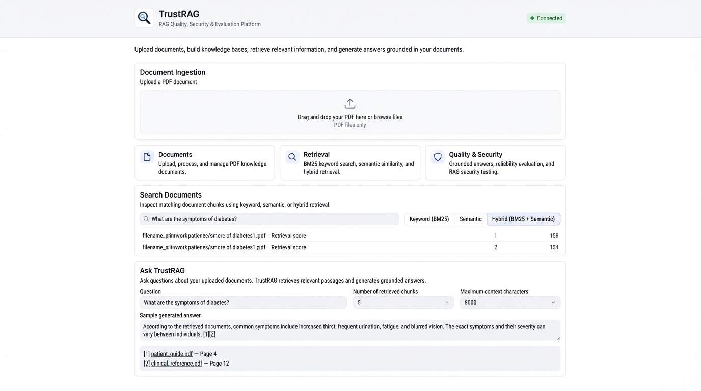
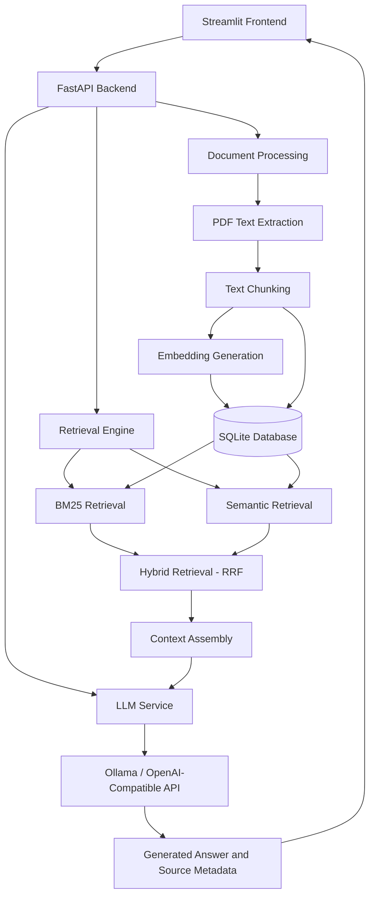

# TrustRAG

### A Quality, Security & Evaluation Platform for Production RAG Systems

TrustRAG is a publicly available software project under active development, focused on building, evaluating, and improving reliable Retrieval-Augmented Generation (RAG) systems.

It provides a modular foundation for document ingestion, hybrid information retrieval, context assembly, and LLM-based answer generation with source references.

Unlike a standalone document chatbot, TrustRAG has a broader goal: helping developers understand, evaluate, and improve the quality, reliability, and security of production RAG applications.

**Current development stage:** Functional MVP with PDF ingestion, BM25 and semantic retrieval, hybrid ranking, context assembly, local LLM integration, and an interactive Streamlit question-answering interface.

---

## Application Preview



*Conceptual UI preview of the TrustRAG application.*

---

## 1. Key Features

### Document Ingestion and Management

- Upload PDF documents through the web interface.
- Validate file extensions, PDF signatures, and file sizes.
- Extract text while preserving page-level information.
- Split extracted text into overlapping chunks.
- Generate embeddings for document chunks.
- Store documents, chunks, and embeddings in SQLite.
- View uploaded documents and their extracted chunks.
- Delete documents and associated records.

### Multiple Retrieval Strategies

TrustRAG currently implements three retrieval approaches.

**Keyword Retrieval — BM25**

- Token-based keyword matching.
- Term-frequency-based relevance scoring.
- Inverse document frequency (IDF).
- Document-length normalization.
- Ranking of relevant document chunks.

**Semantic Retrieval**

- Local embedding generation using Sentence Transformers.
- Embedding model: `sentence-transformers/all-MiniLM-L6-v2`.
- 384-dimensional embeddings.
- Normalized embeddings.
- Cosine similarity-based retrieval.
- Local embedding storage in SQLite.

**Hybrid Retrieval — Reciprocal Rank Fusion (RRF)**

- Combines BM25 and semantic retrieval rankings.
- Uses Reciprocal Rank Fusion.
- Combines ranked results without directly adding incompatible raw retrieval scores.
- Produces a unified ranking of relevant chunks.

### Context Assembly

- Retrieves relevant chunks through hybrid retrieval.
- Removes duplicate chunks.
- Adds source identifiers.
- Preserves filenames, page numbers, and chunk metadata.
- Enforces a configurable context-length limit.
- Returns structured source metadata for answer generation.

### Grounded Answer Generation

- Integrates with locally hosted Ollama models.
- Supports an OpenAI-compatible LLM provider.
- Uses retrieved document excerpts as generation context.
- Instructs the LLM to answer using supplied sources.
- Requests source references such as `[1]` and `[2]`.
- Instructs the model to acknowledge insufficient information rather than invent an answer.
- Treats retrieved document content as untrusted input rather than trusted system instructions.

*Note: Grounding and citation behavior currently relies on prompt instructions. Independent verification of generated claims and citations is planned.*

### Interactive Web Interface

The Streamlit frontend supports:

- PDF upload and processing.
- Document library management.
- Document and chunk inspection.
- BM25 keyword search.
- Semantic search.
- Hybrid search.
- Question answering through the `/ask` API.
- Display of generated answers and supporting source metadata.

---

## 2. Architecture

TrustRAG uses a modular architecture that separates document processing, retrieval, context assembly, persistence, and LLM generation.



### Question-Answering Workflow

When a user submits a question:

1. The Streamlit frontend sends the question to `POST /ask`.
2. FastAPI validates the question and request parameters.
3. The context service retrieves relevant chunks using hybrid retrieval.
4. The context service assembles the retrieved chunks and source metadata.
5. The LLM service sends the question and context to the configured provider.
6. The model generates an answer based on the retrieved document excerpts.
7. The API returns the answer, model name, source metadata, and context statistics.
8. Streamlit displays the answer and its supporting sources.

---

## 3. Technology Stack

| Component | Technology |
|---|---|
| Programming language | Python |
| Backend | FastAPI |
| Frontend | Streamlit |
| API communication | REST / HTTP |
| PDF processing | pypdf |
| Database | SQLite |
| Keyword retrieval | BM25 |
| Embedding framework | Sentence Transformers |
| Embedding model | all-MiniLM-L6-v2 |
| Embedding dimension | 384 |
| Similarity metric | Cosine similarity |
| Hybrid ranking | Reciprocal Rank Fusion |
| Local LLM runtime | Ollama |
| Alternative LLM interface | OpenAI-compatible API |
| HTTP clients | requests, httpx |
| Data validation | Pydantic |
| Automated testing | Pytest |

---

## 4. Project Structure

```text
TrustRAG/
│
├── assets/
│   └── demo.jpeg
│
├── backend/
│   ├── __init__.py
│   ├── requirements.txt
│   │
│   └── app/
│       ├── __init__.py
│       ├── main.py
│       │
│       ├── database/
│       │   ├── __init__.py
│       │   └── database.py
│       │
│       └── services/
│           ├── __init__.py
│           ├── document_processor.py
│           ├── document_storage.py
│           ├── retrieval_service.py
│           ├── embedding_service.py
│           ├── semantic_retrieval_service.py
│           ├── hybrid_retrieval_service.py
│           ├── context_service.py
│           └── llm_service.py
│
├── frontend/
│   └── app.py
│
├── tests/
│   ├── test_document_processor.py
│   ├── test_document_storage.py
│   ├── test_api.py
│   ├── test_retrieval.py
│   ├── test_search_api.py
│   ├── test_bm25.py
│   ├── test_semantic_retrieval.py
│   ├── test_semantic_search_api.py
│   ├── test_hybrid_retrieval.py
│   ├── test_hybrid_search_api.py
│   ├── test_context_service.py
│   └── test_llm_service.py
│
├── .env.example
├── .gitignore
├── README.md
└── requirements.txt
```

The SQLite database (`trustrag.db`) is generated locally when the backend initializes. It is excluded from version control and should not be committed to the repository.

The `.venv` directory is also local and excluded from version control.

---

## 5. Installation and Setup

### Prerequisites

- Python 3.10 or newer.
- Git.
- Ollama for local LLM inference, or access to an OpenAI-compatible API.
- Sufficient memory and storage for the embedding model and selected LLM.

The project has been developed and tested using Python 3.12.

### Step 1 — Clone the Repository

```bash
git clone https://github.com/hamghalam/TrustRAG.git
cd TrustRAG
```

### Step 2 — Create a Virtual Environment

Windows PowerShell:

```powershell
python -m venv .venv
.venv\Scripts\Activate.ps1
```

### Step 3 — Install Dependencies

```powershell
python -m pip install --upgrade pip
pip install -r requirements.txt
```

The root requirements file installs the backend and frontend dependencies.

### Step 4 — Configure the LLM Provider

Create a `.env` file in the project root.

Example configuration for Ollama:

```dotenv
TRUSTRAG_LLM_PROVIDER=ollama
TRUSTRAG_LLM_BASE_URL=http://localhost:11434
TRUSTRAG_LLM_API_KEY=
TRUSTRAG_LLM_MODEL=qwen3.5:0.8b
TRUSTRAG_LLM_TIMEOUT=120
TRUSTRAG_LLM_MAX_TOKENS=1024
```

Make sure Ollama is installed and running.

Download the example model:

```powershell
ollama pull qwen3.5:0.8b
```

Check available models:

```powershell
ollama list
```

The example uses a small local model for development. Model selection should be based on answer quality, latency, memory requirements, and the intended deployment environment.

For an OpenAI-compatible provider, configure the provider and connection settings according to the API being used.

**Important:** Do not commit your `.env` file or API credentials to GitHub.

### Step 5 — Start the Backend

From the project root:

```powershell
uvicorn backend.app.main:app --reload
```

The API will be available at:

- Base URL: http://127.0.0.1:8000
- Interactive API documentation: http://127.0.0.1:8000/docs
- Health check: http://127.0.0.1:8000/health

### Step 6 — Start the Frontend

Open a second terminal, activate the virtual environment, and run:

```powershell
streamlit run frontend/app.py
```

Streamlit will provide a local browser interface.

---

## 6. Using TrustRAG

### Upload a Document

1. Open the Streamlit application.
2. Navigate to Document Ingestion.
3. Upload a PDF file.
4. Process the document.
5. TrustRAG extracts text, creates chunks, generates embeddings, and stores the processed document.

The upload size is subject to the configured backend file-size limit.

The current PDF processing pipeline extracts embedded text. Scanned PDFs that require OCR are not yet supported.

### Search Documents

Navigate to Search Documents and enter a query.

Choose one of the three retrieval methods:

- **Keyword (BM25):** Useful for exact terms, names, and keyword matching.
- **Semantic:** Useful for finding conceptually related passages.
- **Hybrid:** Combines keyword and semantic rankings using RRF.

Search results include document names, page numbers, chunk identifiers, and retrieval scores.

### Ask TrustRAG

Navigate to Ask TrustRAG.

1. Enter a natural-language question.
2. Select the number of retrieved chunks.
3. Set the maximum context size.
4. Submit the question.

The application retrieves relevant passages using hybrid retrieval, assembles context, and sends it to the configured LLM.

The interface displays:

- Generated answer.
- LLM model name.
- Number of source passages.
- Context size.
- Source citation labels.
- Document filenames and page numbers.
- Retrieval metadata where available.

---

## 7. API Reference

Interactive API documentation is available at:

http://127.0.0.1:8000/docs

### Available Endpoints

| Method | Endpoint | Description |
|---|---|---|
| GET | `/` | Project information |
| GET | `/health` | Backend health check |
| POST | `/documents/upload` | Upload and process a PDF |
| GET | `/documents` | List stored documents |
| GET | `/documents/{document_id}` | Retrieve document details and chunks |
| DELETE | `/documents/{document_id}` | Delete a document |
| GET | `/search` | BM25 keyword retrieval |
| GET | `/search/semantic` | Semantic retrieval |
| GET | `/search/hybrid` | Hybrid retrieval |
| POST | `/ask` | Generate a grounded answer |

### Ask Endpoint

`POST /ask`

Example request:

```json
{
  "query": "What are the main findings in the document?",
  "limit": 5,
  "max_context_chars": 8000
}
```

Request parameters:

| Parameter | Default | Constraints |
|---|---:|---|
| `query` | Required | Non-empty string |
| `limit` | 5 | 1–20 |
| `max_context_chars` | 8000 | 500–20000 |

Example response structure:

```json
{
  "query": "What are the main findings in the document?",
  "answer": "The documents indicate ... [1]",
  "model": "qwen3.5:0.8b",
  "source_count": 1,
  "sources": [
    {
      "citation": "[1]",
      "chunk_id": "example-chunk-id",
      "document_id": "example-document-id",
      "filename": "example.pdf",
      "page_number": 3,
      "chunk_index": 0,
      "retrieval_score": 0.02,
      "retrieval_methods": [
        "bm25",
        "semantic"
      ],
      "truncated": false
    }
  ],
  "context_char_count": 1200
}
```

*The response values above are illustrative. Actual values depend on uploaded documents, retrieval results, and the configured model.*

---

## 8. Testing

TrustRAG uses Pytest for automated testing.

Run all tests:

```powershell
python -m pytest -v
```

Run a specific test module:

```powershell
python -m pytest tests/test_llm_service.py -v
```

The existing test suite covers:

- PDF text extraction and chunking.
- Document storage and management.
- API endpoints.
- BM25 retrieval.
- Semantic retrieval.
- Hybrid retrieval and RRF.
- Context assembly.
- LLM provider integration.

Run tests from the project root so that backend package imports resolve correctly.

---

## 9. Current Development Status

| Feature | Status |
|---|---|
| Project foundation | Implemented |
| FastAPI backend | Implemented |
| Streamlit frontend | Implemented |
| PDF ingestion | Implemented |
| Text extraction and chunking | Implemented |
| SQLite persistence | Implemented |
| Document management | Implemented |
| BM25 keyword retrieval | Implemented |
| Semantic embeddings | Implemented |
| Semantic retrieval | Implemented |
| Hybrid retrieval with RRF | Implemented |
| Context assembly | Implemented |
| Ollama integration | Implemented |
| OpenAI-compatible provider | Implemented |
| Grounded answer generation | Implemented |
| Interactive question-answering interface | Implemented |
| Automated citation verification | Planned |
| Answer quality evaluation | Planned |
| Retrieval evaluation metrics | Planned |
| Prompt-injection security testing | Planned |
| Outdated information detection | Planned |
| Conflicting information detection | Planned |
| Evaluation dashboards | Planned |
| PostgreSQL / pgvector support | Future consideration |
| Docker deployment | Planned |

---

## 10. Roadmap

The long-term goal is to evolve TrustRAG from a RAG application foundation into a platform for RAG quality assurance, security testing, and continuous evaluation.

### A. Answer Quality Evaluation

- Faithfulness and groundedness evaluation.
- Answer relevance.
- Context relevance.
- Citation correctness.
- Detection of unsupported claims.
- Evaluation of answer consistency.

### B. Retrieval Evaluation

- Precision and recall.
- Ranking quality metrics.
- Retrieval regression testing.
- Comparison of retrieval configurations.
- Evaluation using curated query and relevance datasets.

### C. RAG Security

- Prompt-injection testing.
- Malicious document-content testing.
- Untrusted-context handling.
- Security regression tests.
- Evaluation of unsafe instruction-following behavior.

### D. Knowledge Quality Management

- Detection of outdated information.
- Identification of contradictory sources.
- Document-level quality monitoring.
- Knowledge-base consistency checks.
- Tracking changes in document content.

### E. Production Readiness

- Evaluation dashboards.
- Reproducible evaluation datasets.
- PostgreSQL and vector database integration.
- Monitoring and observability.
- Containerized deployment.
- Production configuration and access control.

---

## 11. Design Principles

**Traceability**

Generated answers should be connected to identifiable source documents and passages.

**Modularity**

Document processing, retrieval, context assembly, storage, and LLM generation should remain independently maintainable.

**Provider Flexibility**

Local and cloud LLM providers should be interchangeable without redesigning the retrieval pipeline.

**Testability**

Core components should have automated tests and predictable interfaces.

**Security Awareness**

Retrieved documents are untrusted input. Their contents should not be treated as trusted system instructions.

**Incremental Development**

New capabilities should be implemented in manageable stages and validated with tests.

---

## 12. Current Limitations

TrustRAG is an actively developed MVP, not yet a production-certified RAG evaluation or security platform.

Current limitations include:

- PDF text extraction does not include OCR for scanned documents.
- Embeddings are stored in SQLite rather than a dedicated vector database.
- Semantic retrieval is currently implemented locally.
- Answer generation relies on the configured LLM's ability to follow grounding and citation instructions.
- Citation labels are not yet independently verified against every generated claim.
- Automated faithfulness, answer quality, and security evaluation modules are planned rather than implemented.
- Production authentication, multi-user access control, and deployment hardening are not yet included.

These limitations define important areas for future development and evaluation.

---

## 13. License

TrustRAG is currently under active development. A formal open-source license has not yet been added.

Until a license is included in the repository, the project should not be assumed to grant standard open-source reuse, modification, or distribution permissions.

---

## 14. Author

**Mohammad Hamghalam**

Applied AI Research Scientist

- GitHub: https://github.com/hamghalam
- LinkedIn: https://www.linkedin.com/in/hamghalam/

---

*TrustRAG — Building more reliable, transparent, and secure Retrieval-Augmented Generation systems.*